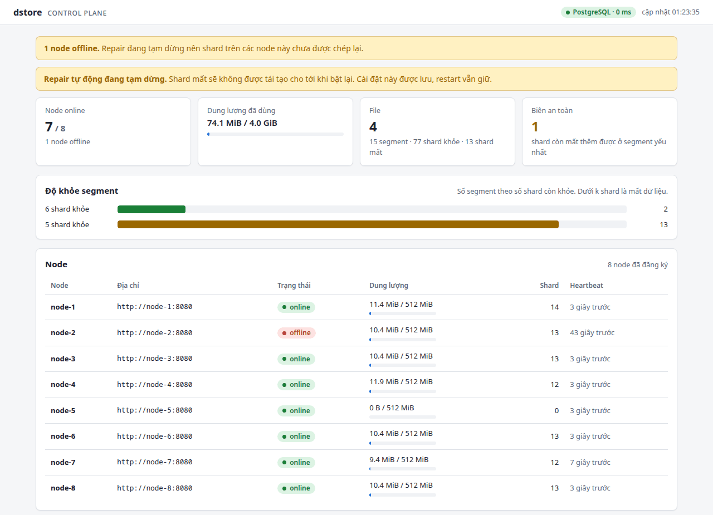
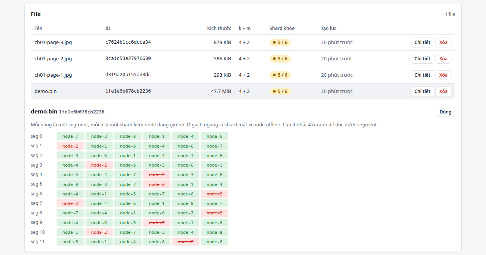
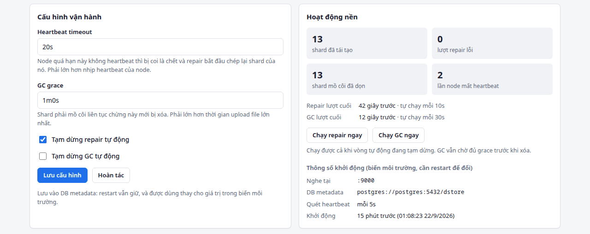
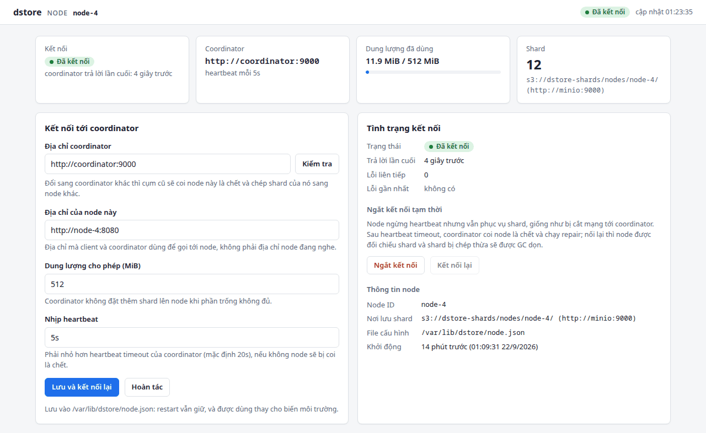

# dstore-demo — kiến trúc

Demo lưu trữ phân tán theo mô hình **control plane tập trung + data plane phân tán**.
Client tự chia file bằng erasure coding Reed-Solomon (`k` data shard + `m` parity shard)
rồi rải shard thẳng lên các node. Mất tới `m` node vẫn đọc được file; coordinator
phát hiện node chết và tự tái tạo shard đã mất lên node khác.

Mặc định demo: `k=4`, `m=2`, segment 4 MB, 8 node — tốn 1.5x dung lượng, chịu mất 2 node cùng lúc.

---

## 1. Kiến trúc tổng quan

### 1.1 Sơ đồ hệ thống

```text
    ┌─────────────────────────────────────────────────┐
    │ Lớp truy cập                                    │
    │   gateway × n   ứng dụng bên ngoài, HTTP        │
    │   dsctl         vận hành, trong mạng nội bộ     │
    └─────────────────────────────────────────────────┘
          │ metadata                   │ byte của shard
          │ plan · commit · manifest   │ PUT / GET song song
          ▼                            ▼
    ┌───────────────┐  heartbeat  ┌───────────────────────┐
    │ coordinator   │◀────────────│ node-1 … node-8       │
    │ control plane │────────────▶│ data plane            │
    └───────────────┘  repair, GC └───────────────────────┘
          │                            │ mỗi node một prefix nodes/<id>/
          ▼                            ▼
    ┌───────────────┐             ┌───────────────────────┐
    │ PostgreSQL    │             │ MinIO / Amazon S3     │
    │ metadata      │             │ byte của shard        │
    └───────────────┘             └───────────────────────┘
          ▲
          └── gateway cũng lưu bảng chủ sở hữu file ở đây
```

| Thành phần | Binary / image | Vai trò |
| --- | --- | --- |
| Gateway | `cmd/gateway` | API công khai: ứng dụng PUT/GET file bằng HTTP thường, không cần biết erasure coding |
| Client | `cmd/dsctl` | Công cụ vận hành: tự encode/decode, upload/download song song thẳng với node |
| Coordinator | `cmd/coordinator` | Registry node, metadata file/shard, chọn node đặt shard, phát hiện node chết, repair, dọn rác; web UI quản trị ở `/ui/` |
| Node | `cmd/node` | Kiểm hash, phục vụ PUT/GET shard, gửi heartbeat; web UI cấu hình kết nối ở `/ui/` |
| PostgreSQL | `postgres:16` hoặc RDS | Metadata của coordinator và bảng chủ sở hữu của gateway |
| MinIO / S3 | `quay.io/minio/minio` hoặc Amazon S3 | Byte của shard |

**Nguyên tắc cốt lõi: dữ liệu không đi qua coordinator.** Coordinator chỉ giữ metadata;
byte của file đi thẳng giữa lớp truy cập và node. Ngoại lệ duy nhất là repair — lúc đó
coordinator phải tự tải shard về để tái tạo.

### 1.2 Bốn lớp

| Lớp | Thành phần | Giữ trạng thái gì | Mở rộng thế nào |
| --- | --- | --- | --- |
| Truy cập | gateway, dsctl | Không gì cả — gateway đọc mọi thứ từ PostgreSQL mỗi request | Thêm bản gateway sau load balancer |
| Control plane | coordinator | Trạng thái cứng ở PostgreSQL, trạng thái mềm trong RAM (xem mục 3) | Chỉ một bản — giới hạn lớn nhất hiện tại |
| Data plane | node | Không gì ngoài shard của chính nó | Thêm node là thêm dung lượng và băng thông |
| Lưu trữ | PostgreSQL, MinIO/S3 | Toàn bộ dữ liệu bền vững | Dịch vụ quản lý (RDS, S3) hoặc tự dựng |

Nhờ vậy mọi tiến trình Go đều **khởi động lại được bất cứ lúc nào** mà không mất dữ liệu:
thứ cần giữ nằm ở lớp lưu trữ, thứ còn lại dựng lại từ heartbeat.

### 1.3 Hai đường vào hệ thống

| | Gateway | dsctl |
| --- | --- | --- |
| Dành cho | Ứng dụng bên ngoài (web, mobile, backend khác) | Người vận hành, script nội bộ |
| Ở đâu | Mở ra ngoài (cổng 8000) | Trong mạng nội bộ, phải gọi thẳng được node |
| Ai làm erasure coding | Gateway | Chính dsctl |
| Byte đi qua | App → gateway → node | dsctl → node |
| Xác thực | API key → tenant, cách ly file giữa tenant | Không có (tin mạng nội bộ) |
| Đọc một đoạn file | Header `Range` | Không hỗ trợ |

Hai đường dùng chung đúng một thư viện ([internal/client](internal/client)); gateway chỉ bọc
thêm HTTP, xác thực và bảng chủ sở hữu.

### 1.4 Bên trong coordinator

```text
                     HTTP API  /nodes  /files  /metrics  /ui
                                   │
    HealthMonitor  mỗi 5 s         ▼          Repairer  mỗi 10 s
    node quá hạn → offline ──▶ ┌───────┐ ◀── segment thiếu shard → tái tạo
                               │ Store │
    Collector  mỗi 60 s    ──▶ │ (RAM) │
    shard mồ côi → xóa         └───────┘
                                   │ trạng thái cứng, ghi ngoài khóa
                                   ▼
                          MetaStore → PostgreSQL
```

`Store` là nơi duy nhất giữ trạng thái; API và ba vòng lặp nền chỉ đọc/ghi qua nó. Mọi truy
vấn đọc từ RAM cho nhanh, còn `MetaStore` chỉ nhận những thay đổi phải sống sót qua restart.

| Vòng lặp | Chu kỳ | Việc | Chạm tới |
| --- | --- | --- | --- |
| [HealthMonitor](internal/coordinator/health.go) | 5 s | Node quá 20 s không heartbeat → `offline`, shard của nó → `lost` | Chỉ RAM |
| [Repairer](internal/coordinator/repair.go) | 10 s | Segment thiếu shard → tải `k` shard, tái tạo, đặt sang node khác | Node + PostgreSQL |
| [Collector](internal/coordinator/gc.go) | 60 s | Shard trên node mà metadata không tham chiếu → xóa (sau thời gian ân hạn) | Node |

Heartbeat timeout, thời gian ân hạn của GC và công tắc tạm dừng repair/GC nằm trong
[Settings](internal/coordinator/settings.go): sửa được lúc đang chạy qua web UI, lưu trong bảng
`settings` của PostgreSQL, và các vòng lặp đọc lại mỗi lượt. Nút "chạy ngay" trên UI chỉ đẩy thêm
một lượt vào đúng goroutine của vòng lặp đó, nên hai lượt repair không bao giờ chạy chồng nhau.

### 1.5 Thành phần nào hỏng thì sao

| Hỏng | Đọc file | Ghi file | Hồi phục |
| --- | --- | --- | --- |
| Tới `m` node cùng giữ một segment | Được — chỉ cần `k` shard | Được, nếu còn ≥ `k+m` node sống | Sau 20 s bị đánh `offline`, repair tái tạo shard sang node khác |
| Hơn `m` node cùng giữ một segment | Segment đó hỏng | Được, nếu còn ≥ `k+m` node sống | Đọc lại được khi đủ node quay lại; mất hẳn thì file thành `damaged` |
| Coordinator | Không — client cần manifest | Không | Khởi động lại: nạp metadata từ PostgreSQL, node heartbeat tiếp như cũ |
| PostgreSQL | Được — coordinator đọc từ RAM; qua gateway thì không, vì cần tra chủ sở hữu | Commit trả 503 | Tự nối lại khi DB lên; coordinator khởi động thì chờ DB |
| MinIO / S3 | Không — node không lấy được byte | Không | Tự hồi phục khi S3 lên; metadata không bị ảnh hưởng |
| Một bản gateway | Các bản khác phục vụ tiếp | Như bên trái | Không cần gì — gateway không giữ trạng thái |

Hai điểm chết đơn còn lại là **coordinator** (chỉ chạy một bản) và **MinIO trong compose**
(mọi node chung một MinIO). Amazon S3 không có vấn đề thứ hai vì nó tự sao chép qua nhiều AZ.

### 1.6 Triển khai

Docker compose ([deploy/docker-compose.yml](deploy/docker-compose.yml)) chạy mọi thứ trên
một máy:

| Dịch vụ | Cổng ra máy host | Ghi chú |
| --- | --- | --- |
| gateway | 8000 | Cửa vào cho ứng dụng — khi triển khai thật, đây là cổng duy nhất mở ra ngoài |
| coordinator | 9000 | API, metrics và web UI `http://localhost:9000/ui/` |
| postgres | 5433 | Xem metadata bằng `psql` |
| minio | 19001 | Giao diện web của MinIO |
| node-1 … node-8 | 8081 … 8088 | Web UI của từng node. Cổng này mở cả API shard ra máy host — chỉ hợp khi demo |
| dsctl | — | `docker compose run`, chạy trong mạng nội bộ |

Trên AWS — **đề xuất, chưa triển khai thử**:

```text
                     Internet
                        │ HTTPS
                        ▼
                  ┌───────────┐
                  │    ALB    │
                  └───────────┘
                        │
  ┌─ VPC, subnet riêng ─┼─────────────────────────────────────────┐
  │                     ▼                                         │
  │              gateway × n                                      │
  │               │         │                                     │
  │               ▼         ▼                                     │
  │      coordinator ◀──▶ node × n                                │
  │               │         │                                     │
  │               ▼         ▼  qua VPC endpoint                   │
  │    RDS / Aurora         Amazon S3, mỗi node một prefix        │
  └───────────────────────────────────────────────────────────────┘
```

| Thành phần | Trên AWS | Ghi chú |
| --- | --- | --- |
| gateway | ECS / EKS, nhiều bản sau ALB | ALB lo TLS; gateway không giữ trạng thái |
| coordinator | ECS / EKS, đúng một bản | Chưa có bầu leader cho nhiều bản |
| node | ECS / EKS / EC2 | IAM role chỉ có quyền trên prefix `nodes/*` |
| PostgreSQL | RDS hoặc Aurora PostgreSQL | TLS + đăng nhập IAM, xem mục 9 |
| MinIO | Amazon S3 | Một bucket, gọi qua VPC endpoint để không ra internet |

**Lưu ý khi đặt node lên S3.** S3 đã tự sao chép qua nhiều AZ, nên erasure coding `k+m` trên
cùng một bucket chủ yếu tốn thêm 1.5x dung lượng mà gần như không tăng độ bền. Erasure coding
phát huy giá trị khi mỗi node có **đĩa riêng, hỏng độc lập với nhau** — máy tự dựng, hoặc EBS /
instance store trải qua nhiều AZ. Trên AWS mà dùng S3 thì cân nhắc đặt `m` nhỏ lại, hoặc cho
node dùng `STORAGE=disk`.

### 1.7 Các quyết định kiến trúc

| Quyết định | Vì sao | Cái giá phải trả |
| --- | --- | --- |
| Control plane tập trung | Một nơi nắm metadata, không cần giao thức đồng thuận | Coordinator là điểm chết đơn: nó chết thì không đọc/ghi được, dù dữ liệu vẫn an toàn |
| Dữ liệu không đi qua coordinator | Coordinator không thành nút thắt băng thông | Client phải tự làm erasure coding — lý do phải có gateway |
| Erasure coding thay vì nhân bản | Chịu mất 2 node với 1.5x dung lượng, thay vì 3x nếu giữ 3 bản sao | Repair phải đọc `k` shard; tốn CPU encode/decode |
| Segment cố định 4 MB | Mỗi lúc chỉ giữ một segment trong RAM; `Range` chỉ tải segment cần | File nhỏ vẫn thành `k+m` object |
| SHA-256 làm ID của shard | Kiểm toàn vẹn ở node, ở client, và cả phía S3 | Tính SHA-256 mọi shard ở cả hai đầu — rẻ so với encode |
| Tách trạng thái cứng / mềm | Ít ghi DB; restart tự hồi phục nhờ heartbeat | Sau restart có tối đa 20 s coi node đã chết là còn sống |
| Gateway nằm trên đường dữ liệu | App dùng HTTP thường; node không lộ ra ngoài | Gateway thành nút thắt băng thông, phải chạy nhiều bản |
| Một bucket S3, mỗi node một prefix | Tên bucket duy nhất toàn cầu; S3 giới hạn tốc độ request theo prefix nên node không giành nhau; phân quyền IAM theo prefix | Mọi node phụ thuộc cùng một bucket |
| Repair ngay khi thiếu 1 shard | Demo dễ quan sát | Mô phỏng cho thấy 80% lượng repair là vô ích — bản thật nên chờ vài giờ (mục 12) |

## 2. Bố cục mã nguồn

```text
cmd/
  coordinator/  node/  dsctl/      # 3 binary của hệ thống chạy thật
  gateway/                         # API công khai cho ứng dụng bên ngoài
  simulator/                       # công cụ chọn tham số, không thuộc đường chạy
internal/
  protocol/     struct JSON dùng chung, một nguồn sự thật cho cả ba thành phần
  ec/           bọc reedsolomon: Encode/Reconstruct/Decode một segment
  shardclient/  client HTTP đọc/ghi shard (dsctl và repair dùng chung)
  node/         store.go (interface)  diskstore.go  s3store.go  api.go  heartbeat.go
                settings.go  admin.go (API của web UI)
  coordinator/  store.go  persist.go  placement.go  api.go  health.go  repair.go  gc.go  metrics.go
                settings.go  admin.go (API của web UI)
  metadb/       metadata của coordinator trong PostgreSQL (schema.sql)
  pgdb/         mở kết nối PostgreSQL, tương thích Amazon RDS (TLS, IAM)
  client/       client.go  upload.go  download.go
  gateway/      gateway.go  auth.go  registry.go
  testcluster/  dựng cụm coordinator + node trong tiến trình test
  sim/          mô phỏng nghìn node để chọn k/m và ngưỡng repair
  webui/        trang HTML/JS nhúng vào binary, đăng nhập và chặn CSRF cho /ui/
deploy/         docker-compose.yml: PostgreSQL + MinIO + coordinator + gateway + 8 node
scripts/        chaos.sh: tắt/bật node ngẫu nhiên
docs/images/    ảnh chụp web UI dùng trong README
```

Phụ thuộc giữa các gói chỉ đi một chiều (kiểm bằng `go list`):

```text
tầng 0   protocol   ec   pgdb   sim    không phụ thuộc gói nội bộ nào
         webui
tầng 1   shardclient                   → ec
tầng 2   node                          → protocol
         coordinator                   → protocol, ec, shardclient
         client                        → protocol, ec, shardclient
tầng 3   metadb                        → coordinator
         gateway                       → client, protocol
tầng 4   cmd/*                         nối mọi thứ lại với nhau
```

- `node`, `coordinator`, `client` chỉ gặp nhau qua `protocol` và qua HTTP.
- `coordinator` **không biết PostgreSQL tồn tại**: nó chỉ định nghĩa interface `MetaStore`,
  còn `metadb` cài đặt interface đó. Gateway làm y hệt với `Owners`, node với `ShardStore`.
- Chỉ các `cmd/*` mới nối mọi thứ lại, nên đổi PostgreSQL sang DB khác hay S3 sang nơi
  khác không phải sửa một dòng nào trong logic lõi.

## 3. Mô hình dữ liệu

Metadata lưu bền trong PostgreSQL ([schema.sql](internal/metadb/schema.sql)), coordinator giữ thêm
một bản trong bộ nhớ ([store.go](internal/coordinator/store.go)) để trả lời nhanh:

```text
Node     (id, addr, capacity, used, shard_count, last_heartbeat, status)
File     (id, name, size, segment_size, k, m, status, committed, created_at)
  └─ Segment  (index, orig_size)
       └─ Shard  (shard_index, hash, node_id, status)
```

Ba chi tiết quyết định việc đọc lại được file:

- **`shard_index` phải lưu** — Reed-Solomon cần biết shard nào là shard số mấy mới tái tạo được.
- **`orig_size` phải lưu** — `Split` đệm thêm byte cho đủ khối, `Join` cần kích thước gốc để cắt phần đệm.
- **`hash` là ID của shard** (SHA-256 nội dung) — cùng lúc là địa chỉ lưu trữ và là cách kiểm tra toàn vẹn.

Trạng thái: shard là `ok` / `lost` / `repairing`; file là `ok` / `damaged`;
file chỉ đọc được sau khi client commit, nên upload dở dang không để lại file hỏng.

### Lưu gì xuống DB, giữ gì trong RAM

Không phải mọi thứ trong coordinator đều cần lưu ([persist.go](internal/coordinator/persist.go)):

| Loại | Gồm | Xử lý |
| --- | --- | --- |
| **Trạng thái cứng** | File gồm segment nào, shard nào nằm trên node nào, địa chỉ node | Mất là mất dữ liệu → ghi xuống PostgreSQL |
| **Trạng thái mềm** | Node sống/chết, shard ok/lost, dung lượng đã dùng | Heartbeat dựng lại trong vài giây → không lưu |
| **Tham số vận hành** | Heartbeat timeout, GC grace, tạm dừng repair/GC — sửa qua web UI | Ghi xuống PostgreSQL, đè lên env ở lần khởi động sau |

Ghi trạng thái mềm thì mỗi 5 giây mỗi node lại một lần ghi DB mà chẳng được gì. Khi khởi động,
coordinator đọc lại trạng thái cứng rồi coi mọi node như vừa heartbeat: node còn sống sẽ tiếp tục
heartbeat, node chết trong lúc coordinator tắt sẽ bị chuyển offline sau một khoảng timeout, và
repair chạy như thường.

Thứ tự ghi được chọn để client không bao giờ nhận một lời hứa sai:

- **Commit**: ghi DB trước, đưa vào bộ nhớ sau — DB lỗi thì trả 503, file chưa tồn tại.
- **Repair**: shard đã nằm ở node mới rồi mới ghi DB. Ghi lỗi thì sau restart metadata trỏ về
  node cũ đã chết → shard lost → repair chạy lại: tốn băng thông nhưng không mất dữ liệu.
- **Xóa**: xóa trong DB trước — lỗi thì chưa có gì thay đổi.

Mọi lần ghi DB diễn ra **ngoài khóa** của store, để một câu SQL chậm không chặn các request khác.

## 4. Các luồng chính

### Upload (`dsctl put file.bin`)

```text
client                          coordinator                 node
  │  POST /files/plan {name,size,k,m,segment} │
  │──────────────────────────────────────────▶│  chọn k+m node khác nhau
  │◀─────────── file_id + node cho từng shard │  cho mỗi segment
  │
  │  với mỗi segment: Split + Encode → k+m shard, tính SHA-256
  │  PUT /shards/{hash} × (k+m), song song, có giới hạn      │
  │─────────────────────────────────────────────────────────▶│ verify hash rồi ghi
  │       lỗi → POST /nodes/pick xin node thay thế → thử lại │
  │
  │  POST /files/{id}/commit {hash, node, orig_size}         │
  │──────────────────────────────────────────▶│  từ đây file mới tồn tại
```

Placement ([placement.go](internal/coordinator/placement.go)): lọc node online còn đủ chỗ,
xáo ngẫu nhiên rồi sắp **ổn định** theo dung lượng trống giảm dần — node trống ngang nhau
được chọn ngẫu nhiên nên shard trải đều thay vì dồn vào một node.

### Download (`dsctl get <file_id>`)

1. Lấy manifest từ coordinator.
2. Với mỗi segment, bắn request tới **tất cả** shard cùng lúc; **đủ `k` shard là hủy phần còn lại**
   bằng `context.CancelFunc` → một node chậm không kéo chậm cả quá trình ([download.go](internal/client/download.go)).
3. Kiểm tra lại SHA-256 từng shard nhận về; sai thì coi như thiếu.
4. Shard thiếu để `nil` → `Reconstruct` → `Join` theo `orig_size` → ghi ra file.

### Heartbeat và phát hiện node chết

- Node gửi heartbeat mỗi **5 s**; coordinator quét mỗi **5 s**.
- Quá **20 s** không heartbeat → node `offline`, mọi shard trên đó chuyển `lost`.
- Node sống lại → coordinator gọi `GET /shards` đối chiếu, shard nào còn trên đĩa được đánh `ok` trở lại
  ([health.go](internal/coordinator/health.go)).

### Repair

Vòng lặp mỗi **10 s** ([repair.go](internal/coordinator/repair.go)), ưu tiên segment ít shard khỏe nhất:

| Số shard khỏe | Xử lý |
| --- | --- |
| `= k+m` | Bỏ qua |
| `≥ k` và `< k+m` | Tải `k` shard về, `Reconstruct` phần thiếu, `PUT` lên node mới **khác** các node đang giữ segment đó, cập nhật metadata |
| `< k` | Không cứu được — đánh dấu file `damaged` và log lỗi |

Demo sửa ngay khi thiếu 1 shard cho dễ quan sát; bản thật nên đặt ngưỡng thấp hơn để đỡ tốn băng thông
(xem mục 12 để biết ngưỡng nào hợp lý).

### Dọn shard mồ côi

Repair tái tạo shard sang node mới, nhưng bản cũ vẫn nằm trên đĩa node chết. Node đó sống lại
là đĩa bị chiếm vĩnh viễn bởi dữ liệu không ai tham chiếu. [gc.go](internal/coordinator/gc.go)
quét mỗi 60 s: hỏi node `GET /shards`, đối chiếu với metadata, hash nào không được tham chiếu
thì `DELETE`.

Chỗ dễ sai là **shard đang upload**: client PUT shard lên node *trước khi* commit, nên trong
khoảng đó coordinator chưa biết hash và shard trông y hệt shard mồ côi. Vì vậy một shard phải
bị thấy là mồ côi **liên tục suốt thời gian ân hạn** (`GC_GRACE`, mặc định 2 phút) qua nhiều
lượt quét rồi mới bị xóa — ân hạn phải lớn hơn thời gian upload một file.

## 5. Node lưu shard thế nào

Node lo phần giao thức (heartbeat, kiểm hash, API); còn byte nằm ở đâu thì do
[`ShardStore`](internal/node/store.go) quyết định, chọn bằng `STORAGE`:

| `STORAGE` | Nơi cất | Dùng khi |
| --- | --- | --- |
| `s3` | Object `<prefix><hash>` trong MinIO hoặc Amazon S3 ([s3store.go](internal/node/s3store.go)) | Chạy thật, docker compose |
| `disk` | File `data/ab/cd/<hash>` trên đĩa local ([diskstore.go](internal/node/diskstore.go)) | Test, chạy nhanh không cần MinIO |

Với S3:

- **Một bucket dùng chung, mỗi node một prefix** `nodes/<id>/`. Tên bucket trên AWS là duy nhất
  toàn cầu, nên không thể mỗi node một bucket tên `node-1`.
- Đọc hết shard vào RAM (cỡ 1 MB) để **kiểm SHA-256 trước khi ghi**, rồi gửi kèm chính SHA-256 đó
  trong `x-amz-checksum-sha256` để **S3 kiểm lại phía server** — byte hỏng trên đường truyền bị từ
  chối, có test chứng minh MinIO làm đúng vậy.
- Không cần file tạm như trên đĩa: `PutObject` của S3 là nguyên tử.

Với đĩa: chia thư mục theo 2 cặp ký tự đầu của hash để một thư mục không chứa hàng vạn file,
ghi ra **file tạm rồi `rename`** nên không bao giờ có shard ghi dở.

Cả hai đều từ chối nội dung không khớp hash trong URL, và đếm lại shard đang có khi khởi động.

Content addressing làm hai việc cùng lúc: chống dữ liệu hỏng, và khiến cùng một nội dung
chỉ chiếm một file trên node.

## 6. API

**Coordinator**

| Method | Path | Mô tả |
| --- | --- | --- |
| POST | `/nodes/register` | Node đăng ký → `{node_id}` |
| POST | `/nodes/{id}/heartbeat` | `{used_bytes, shard_count}` |
| GET | `/nodes` | Danh sách node + trạng thái |
| POST | `/nodes/pick` | Xin node thay thế khi upload gặp node lỗi |
| POST | `/files/plan` | Kế hoạch: node nào giữ shard nào của segment nào |
| POST | `/files/{id}/commit` | Báo shard đã lên node, kèm hash và `orig_size` |
| GET | `/files/{id}` | Manifest để tải file |
| GET | `/files` | Danh sách file |
| DELETE | `/files/{id}` | Xóa metadata + gửi lệnh xóa shard xuống node |
| GET | `/metrics` | Số liệu dạng Prometheus |

**Node**

| Method | Path | Mô tả |
| --- | --- | --- |
| PUT | `/shards/{hash}` | Ghi shard, verify hash |
| GET / HEAD / DELETE | `/shards/{hash}` | Đọc / kiểm tra / xóa |
| GET | `/shards` | Liệt kê hash đang giữ (dùng đối chiếu, dọn rác) |
| GET | `/healthz` | Health check |

**Web UI** — cả hai dịch vụ phục vụ trang ở `GET /ui/` (`GET /` chuyển hướng tới đó) và một API
JSON riêng cho trang dưới `/ui/api/`, cùng lớp đăng nhập ([webui.go](internal/webui/webui.go)):

| Dịch vụ | Method | Path | Mô tả |
| --- | --- | --- | --- |
| coordinator | GET | `/ui/api/overview` | Số liệu cụm, bộ đếm, settings, thông số khởi động, DB còn trả lời không |
| coordinator | PUT | `/ui/api/settings` | `{heartbeat_timeout, gc_grace, repair_paused, gc_paused}`, lưu DB trước rồi mới áp dụng |
| coordinator | POST | `/ui/api/repair`, `/ui/api/gc` | Chạy thêm một lượt ngay, kể cả khi đang tạm dừng |
| node | GET | `/ui/api/status` | Cấu hình kết nối, tình trạng kết nối, dung lượng, nơi lưu shard |
| node | PUT | `/ui/api/settings` | `{coordinator_url, addr, capacity, heartbeat_interval}`, ghi `CONFIG_FILE` rồi đăng ký lại |
| node | POST | `/ui/api/test-connection` | Thử gọi `GET /nodes` của một coordinator trước khi lưu |
| node | POST | `/ui/api/disconnect`, `/ui/api/connect` | Ngắt / nối lại heartbeat |

Danh sách node, file, manifest và shard thì trang đọc thẳng từ API ở trên, không có bản sao riêng.

## 7. API gateway cho ứng dụng bên ngoài

`dsctl` chạy được là nhờ nó nằm **trong** mạng nội bộ: nó gọi thẳng từng node, và
nó tự làm erasure coding. Một ứng dụng thật (web, mobile, backend khác) không có
cả hai điều đó. Gateway lấp đúng khoảng trống này.

### Nó cần những gì

| Yêu cầu | Vì sao | Cách làm ở đây |
| --- | --- | --- |
| Giao diện HTTP thường | App không nên phải cài thư viện EC hay biết node là gì | `PUT`/`GET /v1/files/...`, body là nội dung thô |
| Xác thực + nhiều tenant | Hệ thống lõi không có khái niệm chủ sở hữu | API key → tenant; file của tenant khác trả 404 |
| Stream, không giữ cả file trong RAM | Gateway nằm trên đường dữ liệu, file có thể hàng GB | Mỗi lúc chỉ giữ một segment 4 MB |
| Đọc một đoạn giữa file | Xem video, đọc một trang truyện, resume download | `Range` → chỉ tải đúng segment chứa đoạn đó |
| Chặn quá tải | Một đợt tải đột biến có thể dập chết node | Giới hạn kích thước file và số request dữ liệu đồng thời |
| Không lộ hạ tầng | Địa chỉ node là chuyện nội bộ | Gateway không bao giờ trả manifest hay địa chỉ node ra ngoài |
| Biết kích thước trước khi ghi | Coordinator cần số segment để lập kế hoạch đặt shard | Bắt buộc `Content-Length`, thiếu thì trả 411 |

Đánh đổi lớn nhất: **dữ liệu phải đi qua gateway**, khác với dsctl đi thẳng tới node.
Vì vậy gateway là điểm nghẽn băng thông, phải chạy nhiều bản (nó không giữ trạng thái
gì ngoài bảng chủ sở hữu file) và là thành phần duy nhất mở ra internet.

### API

| Method | Path | Mô tả |
| --- | --- | --- |
| PUT | `/v1/files/{name}` | Upload, body là nội dung. Trả `{file_id, name, size}` |
| GET | `/v1/files/{id}` | Tải file; hỗ trợ `Range` (206 + `Content-Range`) |
| HEAD | `/v1/files/{id}` | Kích thước và kiểu nội dung, không đọc shard |
| GET | `/v1/files` | Danh sách file của tenant |
| DELETE | `/v1/files/{id}` | Xóa file |
| GET | `/healthz` | Health check |

Mọi endpoint `/v1` đòi `Authorization: Bearer <api key>`.

### Chạy thử

```bash
make up   # gateway mở cổng 8000, coordinator và node ở trong mạng nội bộ

curl -X PUT --data-binary @chuong-01.bin \
  -H "Authorization: Bearer demo-key" \
  http://localhost:8000/v1/files/chuong-01.bin
# {"file_id":"8ee1a5b1e4df5ede","name":"chuong-01.bin","size":20000000}

curl -H "Authorization: Bearer demo-key" \
  http://localhost:8000/v1/files/8ee1a5b1e4df5ede -o tai-ve.bin

curl -H "Authorization: Bearer demo-key" -H "Range: bytes=10000000-10000999" \
  http://localhost:8000/v1/files/8ee1a5b1e4df5ede -o mot-doan.bin
```

Đo trên file 20 MB, gọi từ ngoài mạng Docker:

| Thao tác | Thời gian | Byte truyền |
| --- | --- | --- |
| Tải cả file | 46 ms | 20 000 000 |
| Đọc 1000 byte giữa file (`Range`) | 11 ms | 1 000 |

Đọc một đoạn không phải tải cả file vì segment có kích thước cố định: gateway tính
ra ngay segment nào chứa đoạn cần và bỏ qua phần còn lại.

### Cấu hình

| Biến | Mặc định | Ý nghĩa |
| --- | --- | --- |
| `API_KEYS` | `demo-key:demo` | Danh sách `key:tenant`, cách nhau bằng dấu phẩy |
| `MAX_UPLOAD_BYTES` | 512 MB | File lớn hơn bị từ chối ngay từ header |
| `MAX_CONCURRENT` | 32 | Số request dữ liệu chạy cùng lúc, vượt thì trả 503 |
| `EC_K` / `EC_M` / `SEGMENT_SIZE` | 4 / 2 / 4 MB | Tham số erasure coding khi gateway ghi file |

### Bảng chủ sở hữu file nằm ở PostgreSQL

Gateway chạy nhiều bản song song (nó nằm trên đường dữ liệu nên phải scale ngang), và upload qua
bản này rồi tải qua bản khác là chuyện thường. Vì vậy bảng "file nào của tenant nào" nằm trong
PostgreSQL và được đọc thẳng mỗi request, không cache trong RAM từng bản. Ghi bảng này lỗi sau khi
upload xong thì gateway xóa luôn file vừa ghi, thay vì để lại một file vô chủ không ai đọc được.

### Chưa làm

- **API key tĩnh trong biến môi trường** — bản thật cần token ký có hạn dùng và thu hồi được.
- **Chưa có idempotency key**: client retry upload sẽ tạo file thứ hai.
- **Chưa rate limit theo tenant**, mới chỉ giới hạn tổng số request đồng thời.
- **Chưa có TLS và CORS** — cần khi đưa ra internet hoặc cho trình duyệt gọi thẳng.

## 8. Chạy demo

```bash
make up          # build binary + bật PostgreSQL, MinIO, coordinator, gateway, 8 node
make demo-file   # tạo deploy/work/demo.bin 50MB, in SHA-256
make put FILE=demo.bin
make nodes       # xem shard rải trên các node
make get ID=<file_id> OUT=out.bin
make logs        # coordinator phát hiện node chết và repair
make down
```

`dsctl` chạy **trong** mạng Docker (`docker compose run --rm dsctl ...`) vì nó gọi thẳng node
qua tên container. File cần upload đặt trong `deploy/work/`.

**Cụm không cần internet** (chỉ cần kéo image PostgreSQL và MinIO một lần): container chỉ gọi
nhau qua DNS nội bộ của Docker. `make up` build
binary tĩnh ngoài host rồi image chỉ `COPY` vào, nên `docker build` cũng không cần mạng.
Máy nào build có mạng thì thay `Dockerfile` bằng bản multi-stage quen thuộc:

```dockerfile
FROM golang:1.26-alpine AS build
WORKDIR /src
COPY . .
RUN CGO_ENABLED=0 go build -o /out/ ./cmd/...

FROM alpine:3.20
COPY --from=build /out/ /app/
```

Chạy không cần Docker — không đặt `DATABASE_URL` và `STORAGE` thì metadata nằm trong RAM,
shard nằm trên đĩa, đủ để thử nhanh:

```bash
make build
./bin/coordinator &                                              # cổng 9000
NODE_ID=node-1 LISTEN_ADDR=:8081 NODE_ADDR=http://localhost:8081 DATA_DIR=/tmp/n1 ./bin/node &
# ... đủ k+m node (mặc định 6)
./bin/dsctl put ./file.bin
```

### Web UI quản trị

| Trang | Địa chỉ | Làm được gì |
| --- | --- | --- |
| Control plane | http://localhost:9000/ui/ | Tổng quan cụm, độ khỏe segment, bảng node, bảng file và shard của từng file nằm ở node nào, xóa file; sửa heartbeat timeout và GC grace; tạm dừng hoặc chạy ngay repair/GC |
| Node | http://localhost:8081/ui/ … 8088 | Tình trạng kết nối tới coordinator; đổi coordinator, địa chỉ, dung lượng, nhịp heartbeat; thử kết nối trước khi lưu; ngắt/nối lại heartbeat; xem shard đang giữ |

Đăng nhập bằng `admin` / `dstore-ui` (`UI_PASSWORD` trong compose). Để trống `UI_PASSWORD` thì UI
không cần đăng nhập và service ghi cảnh báo vào log. Request ghi (lưu, xóa, ngắt kết nối) đến từ
trang web khác bị chặn bằng `http.CrossOriginProtection`, vì trình duyệt tự gửi kèm mật khẩu đã nhớ.

Ảnh dưới chụp trên cụm compose lúc repair đang tạm dừng và node-2 vừa bị ngắt kết nối:



*Tổng quan: cảnh báo ở đầu trang, biên an toàn còn 1 shard, 13 segment tụt xuống 5/6, node-2 `offline`.*



*Bấm **Chi tiết** ở một file để xem từng shard nằm trên node nào; ô gạch đỏ là shard trên node đang offline.*



*Cấu hình vận hành (lưu vào PostgreSQL) và hoạt động nền: bộ đếm, lượt chạy cuối, nút chạy ngay repair/GC.*

Cấu hình sửa qua UI **thắng env** ở những lần khởi động sau: coordinator lưu trong PostgreSQL, node
lưu vào `CONFIG_FILE` (trong compose là `/var/lib/dstore/node.json` — còn sau `docker compose
restart`, mất khi container bị tạo lại). Những gì gắn với danh tính và dữ liệu — `NODE_ID`, nơi lưu
shard, `DATABASE_URL`, chu kỳ các vòng lặp — UI chỉ hiển thị, đổi thì sửa env rồi restart.



*Trang của một node: đổi coordinator, địa chỉ, dung lượng, nhịp heartbeat (lưu vào `CONFIG_FILE`),
thử kết nối trước khi lưu, ngắt/nối lại heartbeat.*

Trang là HTML + JavaScript thuần nhúng vào binary bằng `go:embed`: không có bước build frontend,
không tải gì từ internet, tự làm mới mỗi 3 giây.

Nút **Ngắt kết nối** ở trang node cho phép diễn một vụ node chết mà không cần `docker stop`: node
ngừng heartbeat nhưng vẫn phục vụ shard. Đã chạy thật trên cụm compose:

| Bước | Kết quả |
| --- | --- |
| Tạm dừng repair ở trang coordinator, ngắt kết nối node-5 | Sau timeout node-5 `offline`, 13 segment tụt xuống 5/6, trang hiện cảnh báo, repair đứng yên |
| `docker restart coordinator` | Vẫn tạm dừng — settings nạp lại từ PostgreSQL |
| Bấm **Chạy repair ngay** | Tái tạo 13 shard, mọi segment về 6/6 dù repair tự động vẫn tạm dừng |
| Nối lại node-3 sau khi shard của nó đã được repair sang node khác | Coordinator đối chiếu, GC dọn 11 bản cũ sau thời gian ân hạn |
| Đổi dung lượng node-7 qua UI, `docker restart node-7` | Node dùng cấu hình đã lưu, coordinator nhận dung lượng mới ngay khi node đăng ký lại |

### Quan sát cụm

`GET /metrics` xuất số liệu theo định dạng Prometheus. Quan trọng nhất là
`dstore_segments_health{healthy="n"}` — số segment đang có đúng `n` shard khỏe,
tức cụm đang cách mất dữ liệu bao xa.

```bash
make watch          # bảng mức độ khỏe theo thời gian, làm mới mỗi 5 s
make chaos          # ở terminal khác: tắt/bật node ngẫu nhiên
```

Tắt 2 trong 8 node rồi để repair chạy, bảng hiện đúng diễn biến:

```text
GIỜ      NODE  TÁI TẠO  DỌN RÁC  SEGMENT THEO SỐ SHARD KHỎE
21:27:01 8     0        0        6:8
21:27:06 6     0        0        4:4 5:4     ← mất 2 node, 8 segment tụt xuống 4-5 shard
21:27:16 6     12       0        6:8         ← repair tái tạo 12 shard, khỏe trở lại
21:29:20 8     12       12       6:8         ← node quay lại, GC dọn 12 bản cũ
```

Tự viết định dạng Prometheus thay vì kéo `client_golang` về, cho gọn dependency;
muốn đổi sang thư viện đó chỉ phải thay `WriteMetrics` trong
[metrics.go](internal/coordinator/metrics.go).

### Kịch bản đã chạy thật

| Bước | Kết quả |
| --- | --- |
| `put demo.bin` 50 MB | 12 segment × 6 shard = 72 shard, rải 8–11 shard mỗi node |
| `docker stop node-2 node-5` | `get` vẫn ra file khớp SHA-256 bản gốc |
| Sau ~20 s | `node mất heartbeat -> offline` (8 + 10 shard `lost`), repair tái tạo đúng 18 shard lên node khác |
| `docker stop node-1 node-3` (4/8 node chết) | vẫn tải được, hash vẫn khớp |
| Tắt 3 node cùng giữ shard của một segment, trước khi repair kịp chạy | `lỗi: segment 0: chỉ lấy được 3 shard, cần tối thiểu 4` — đúng giới hạn `m=2` |

`make chaos` chạy hỗn loạn liên tục (luôn giữ ≥ `k+m` node sống).

## 9. Chạy trên AWS

Thư viện được chọn để cùng một binary chạy được cả với dịch vụ tự dựng lẫn dịch vụ của AWS:

| Thành phần | Thư viện | Tự dựng | AWS |
| --- | --- | --- | --- |
| Metadata | `jackc/pgx/v5` | PostgreSQL | RDS for PostgreSQL, Aurora PostgreSQL |
| Byte của shard | `aws-sdk-go-v2/service/s3` | MinIO | Amazon S3 |
| Đăng nhập DB bằng IAM | `aws-sdk-go-v2/feature/rds/auth` | — | RDS IAM authentication |

Chọn SDK chính thức của AWS thay vì `minio-go` vì nó có đủ chuỗi xác thực của AWS: IAM role của
ECS task / EC2 / EKS (IRSA), SSO, profile, assume role — trên AWS không cần nhét khóa tĩnh vào đâu cả.
MinIO vẫn chạy được qua endpoint tùy chỉnh.

### S3

```bash
STORAGE=s3
S3_BUCKET=ten-bucket-cua-ban      # bucket tạo sẵn bằng Terraform/console
AWS_REGION=ap-southeast-1
# bỏ S3_ENDPOINT, S3_FORCE_PATH_STYLE, S3_CREATE_BUCKET và AWS_ACCESS_KEY_ID/SECRET:
# node lấy quyền từ IAM role
```

Role của node chỉ cần `s3:GetObject`, `s3:PutObject`, `s3:DeleteObject` trên
`arn:aws:s3:::<bucket>/nodes/*` và `s3:ListBucket` trên bucket — không cần quyền tạo bucket.

### RDS / Aurora PostgreSQL

```bash
DATABASE_URL="postgres://dstore@mydb.xxxx.ap-southeast-1.rds.amazonaws.com:5432/dstore?sslmode=verify-full&sslrootcert=/etc/ssl/rds-global-bundle.pem"
DB_IAM_AUTH=true        # đăng nhập bằng token IAM thay cho mật khẩu
DB_AUTO_MIGRATE=false   # nếu user DB không có quyền tạo bảng; chạy schema.sql trước bằng migration
AWS_REGION=ap-southeast-1
```

- **IAM auth**: token chỉ sống 15 phút nên được sinh mới mỗi lần mở kết nối
  ([pgdb.go](internal/pgdb/pgdb.go)). Bật IAM mà tắt TLS thì báo lỗi ngay lúc khởi động, vì RDS từ
  chối đăng nhập IAM qua kết nối không mã hóa. Role cần quyền `rds-db:connect`.
- **Sau RDS Proxy**: thêm `default_query_exec_mode=exec` vào `DATABASE_URL` để prepared statement
  không làm proxy ghim phiên. Câu tạo bảng nhiều lệnh vẫn chạy được vì `pgx` luôn dùng simple
  protocol cho câu không có tham số.

**Đã kiểm chứng**: toàn bộ luồng với PostgreSQL và MinIO thật. **Chưa kiểm chứng trên AWS thật**:
đăng nhập IAM mới được test ở mức token ký đúng định dạng (sinh token không cần gọi AWS), chưa
chạy trên một RDS thật.

## 10. Cấu hình

| Tham số | Mặc định | Đặt ở đâu |
| --- | --- | --- |
| k / m | 4 / 2 | cờ `-k`, `-m` của dsctl |
| Segment size | 4 MB (shard 1 MB) | cờ `-segment` của dsctl |
| Heartbeat | 5 s | `HEARTBEAT_INTERVAL` (node), hoặc web UI node |
| Timeout node chết | 20 s | `HEARTBEAT_TIMEOUT` (coordinator), hoặc web UI coordinator |
| Chu kỳ repair | 10 s | `REPAIR_INTERVAL` (coordinator) |
| Chu kỳ dọn rác | 60 s | `GC_INTERVAL` (coordinator) |
| Ân hạn dọn rác | 2 phút | `GC_GRACE` (coordinator), hoặc web UI coordinator |
| Tạm dừng repair / GC | tắt | Chỉ qua web UI coordinator |
| Dung lượng node | 512 MB | `CAPACITY_BYTES` (node), hoặc web UI node |
| Coordinator mà node kết nối | `http://localhost:9000` | `COORDINATOR_URL` (node), hoặc web UI node |
| Nơi cất shard | `s3` trong compose | `STORAGE` (node): `s3` hoặc `disk` |
| Bucket / prefix | `dstore-shards` / `nodes/<id>/` | `S3_BUCKET`, `S3_PREFIX` (node) |
| Endpoint S3 | trống = Amazon S3 | `S3_ENDPOINT`, `S3_FORCE_PATH_STYLE`, `S3_CREATE_BUCKET` (node) |
| Metadata | trống = chỉ trong RAM | `DATABASE_URL` (coordinator, gateway) |
| Đăng nhập DB | mật khẩu | `DB_IAM_AUTH`, `DB_AUTO_MIGRATE` (coordinator, gateway) |
| Mật khẩu web UI | trống = không cần đăng nhập | `UI_PASSWORD` (coordinator, node), tên đăng nhập `admin` |
| Nơi node lưu cấu hình sửa qua UI | trống = không lưu | `CONFIG_FILE` (node) |

Tham số có "hoặc web UI": env là giá trị mặc định, bản đã sửa qua UI (trong PostgreSQL hoặc
`CONFIG_FILE`) được dùng thay ở những lần khởi động sau.

Node còn đọc `NODE_ID`, `NODE_ADDR`, `LISTEN_ADDR`, `COORDINATOR_URL`, `DATA_DIR` (khi `STORAGE=disk`);
khóa S3 và region theo chuẩn AWS: `AWS_ACCESS_KEY_ID`, `AWS_SECRET_ACCESS_KEY`, `AWS_REGION`.

## 11. Test

```bash
make test              # go test ./... — không cần gì ngoài Go
make test-integration  # tự bật MinIO + PostgreSQL trong Docker rồi chạy cả test cần chúng
make race              # go test -race ./...
```

Test cần dịch vụ thật tự bỏ qua khi không có `DSTORE_TEST_S3_ENDPOINT` /
`DSTORE_TEST_DATABASE_URL`. Test PostgreSQL chạy trong một schema riêng rồi xóa đi, nên
trỏ vào DB đang có dữ liệu cũng không sao.

| Test | Kiểm chứng |
| --- | --- |
| `internal/ec` | Bỏ ngẫu nhiên ≤ m shard vẫn khôi phục đúng; thiếu quá m thì báo lỗi; shard tái tạo giống hệt bản gốc |
| `internal/node` | Cùng một bộ kiểm tra cho cả đĩa và S3: PUT/GET/HEAD/DELETE, từ chối sai hash, không đếm trùng, đếm lại sau restart; S3 từ chối checksum sai phía server. Đổi coordinator lúc đang chạy thì thôi heartbeat bên cũ; ngắt rồi nối lại thì đăng ký lại; lỗi liên tiếp được ghi nhận; file cấu hình giữ giá trị env cho trường còn thiếu; phép thử kết nối nhận ra địa chỉ không phải coordinator |
| `internal/metadb` | Ghi rồi đọc ra y nguyên thứ tự segment/shard, repair cập nhật vị trí, commit lại không nhân đôi, xóa file kéo theo segment và shard; settings còn sau restart |
| `internal/pgdb` | Token IAM cho RDS ký đúng, bật IAM mà tắt TLS thì báo lỗi |
| `internal/client` | Upload/download khớp từng byte; tắt node vẫn đọc được; repair đưa lại `k+m`; mất quá m thì hỏng; node quay lại được khôi phục shard |
| `internal/coordinator` | Restart khôi phục đúng file và vị trí shard sau repair; node chết trong lúc coordinator tắt vẫn bị phát hiện; DB chết thì commit trả 503. GC xóa shard mồ côi nhưng giữ shard đang tham chiếu, không đụng shard vừa commit trong thời gian ân hạn, dọn bản cũ sau repair, bỏ qua node offline; metrics phản ánh đúng mức độ khỏe và counter. Settings sai bị từ chối mà không đổi gì, đúng thì còn sau restart, DB chết thì 503; tạm dừng repair thì vòng tự động đứng yên còn nút chạy ngay vẫn chạy |
| `internal/gateway` | Bảng chủ sở hữu chạy giống nhau trên RAM và PostgreSQL. Upload/download qua HTTP khớp byte, đòi API key, cách ly tenant, Range đúng 4 dạng header, chặn file quá lớn và tên có `%2F` |
| `internal/webui` | Trang, file tĩnh và API cùng nằm dưới `/ui/`; mọi file mà trang tham chiếu đều có thật; sai mật khẩu trả 401; request ghi từ trang web khác trả 403, còn curl vẫn gọi được |
| `internal/sim` | Không node nào hỏng thì không repair; m lớn hơn mất ít hơn; chờ lâu hơn bớt repair thừa; ngưỡng cao đổi phơi nhiễm lấy băng thông; cùng seed ra cùng kết quả |

`internal/client/e2e_test.go` dựng nguyên cụm coordinator + 8 node **trong tiến trình test**,
chạy đúng luồng thật mà không cần Docker.

## 12. Chọn k, m và ngưỡng repair bằng mô phỏng

Demo chạy 8 node nên không trả lời được "nên chọn k/m bao nhiêu" hay "có nên repair
ngay khi mất shard đầu tiên không". [internal/sim](internal/sim/sim.go) mô phỏng cụm
hàng nghìn node theo bước 1 giờ: node hỏng theo phân phối mũ, phần lớn chỉ là **tạm
nghỉ** (restart, mất mạng) rồi quay lại cùng dữ liệu, phần còn lại **chết hẳn** và mất
dữ liệu; coordinator repair trong giới hạn băng thông.

```bash
make sim                                  # chạy cả ba phép so sánh
go run ./cmd/simulator -compare km        # so các cặp k/m
go run ./cmd/simulator -compare threshold # so ngưỡng và độ trễ repair
go run ./cmd/simulator -compare bandwidth # so năng lực repair
```

Các phép so sánh đều quy về **cùng lượng dữ liệu gốc** (mặc định 200 GB, 1000 node,
3 năm), nếu không thì cấu hình k lớn sẽ lưu nhiều dữ liệu hơn và so băng thông là sai.

### Kết quả: k/m

| K/M | Dư thừa | Segment mất | Độ bền | Repair 3 năm |
| --- | --- | --- | --- | --- |
| 4/1 | 1.25x | 27 | 5 số 9 | 2596 GB |
| 4/2 | 1.50x | 0 | 100% | 3045 GB |
| 6/2 | 1.33x | 0 | 100% | 3820 GB |
| 8/2 | 1.25x | 0 | 100% | 4599 GB |
| 10/4 | 1.40x | 0 | 100% | 6292 GB |

`m = 1` là ranh giới rõ rệt: chỉ cấu hình này mất dữ liệu. Từ `m = 2` trở lên không
mất segment nào trong 3 năm, nên **`k=4, m=2` của demo là lựa chọn hợp lý**.

Điều đáng chú ý hơn: mã rộng (k lớn) tiết kiệm dung lượng nhưng **đắt băng thông repair**.
`10/4` chỉ tốn 1.40x dung lượng so với 1.50x của `4/2`, nhưng repair tốn gấp đôi —
vì mỗi shard hỏng phải đọc `k` shard mới tái tạo được.

### Kết quả: ngưỡng và độ trễ repair — phần đáng giá nhất

| Ngưỡng | Chờ | Repair 3 năm | Repair thừa | Không đọc được | Segment mất |
| --- | --- | --- | --- | --- | --- |
| 1 | 0h | 4479 GB | 80% | 0 | 0 |
| 1 | 1h | 3221 GB | 70% | 0 | 0 |
| 1 | 6h | 1089 GB | 14% | 3 seg·h | 0 |
| 2 | 1h | 761 GB | 0% | 57 seg·h | 0 |
| 2 | 6h | 774 GB | 0% | 53 seg·h | 1 |

Repair ngay khi mất shard đầu tiên thì **80% lượng repair là vô ích** — node chỉ tạm
nghỉ vài giờ rồi quay lại với nguyên dữ liệu. Chỉ cần **chờ 6 giờ** đã cắt băng thông
repair xuống còn **1/4** mà gần như không ảnh hưởng khả năng đọc.

Đẩy tiếp lên ngưỡng 2 (chỉ sửa khi thiếu từ 2 shard) thì hết sạch repair thừa nhưng
segment bắt đầu có lúc không đọc được, và ngưỡng 2 + chờ 6 giờ đã làm mất 1 segment.
Với `m=2`, **ngưỡng 1 + chờ vài giờ** là điểm cân bằng tốt.

### Kết quả: năng lực repair

| Repair/giờ | Thời gian thiếu shard | Repair 3 năm | Repair thừa |
| --- | --- | --- | --- |
| 10 | 10234k seg·h | 1281 GB | 33% |
| 20 | 1972k seg·h | 2565 GB | 67% |
| 35 | 935k seg·h | 3181 GB | 71% |
| 100 | 892k seg·h | 2954 GB | 69% |
| 500 | 919k seg·h | 3084 GB | 72% |

Cụm này chỉ mất ~7 shard/giờ vì node chết hẳn, nhưng phải có **~35 shard/giờ** mới
hết tồn đọng — phần dư là để chạy theo các node tạm nghỉ. Nhanh hơn mức đó không
cải thiện gì thêm; chậm hơn thì thời gian segment ở trạng thái thiếu shard tăng vọt
(10 shard/giờ: gấp 11 lần), và đó chính là lúc rủi ro mất dữ liệu tích lũy.

Mô hình giả định **các node hỏng độc lập** và bỏ qua hỏng theo cụm (mất điện cả rack,
lỗi firmware hàng loạt), nên con số dùng để **so sánh các cấu hình với nhau**, không
phải dự báo tuyệt đối.

## 13. Giới hạn đã biết

- **Chưa có bảo mật**: không xác thực node, không ký request, không mã hóa dữ liệu.
  Bất kỳ ai trong mạng cũng đăng ký làm node hoặc đọc shard được.
- **Coordinator vẫn là điểm chết đơn**: metadata đã bền trong PostgreSQL nên restart không mất gì,
  nhưng chỉ chạy được một bản coordinator — chưa có bầu leader cho nhiều bản.
- **Một MinIO dùng chung trong compose**: tắt một node thì shard của nó không đọc được, đúng như
  demo cần; nhưng mọi byte vẫn nằm trên một MinIO, MinIO chết là cả cụm chết. Trên Amazon S3 thì
  không sao (S3 tự sao chép qua nhiều AZ); tự dựng thì mỗi node nên đi với MinIO/đĩa riêng.
- **Node liệt kê cả prefix khi khởi động** để đếm shard — nhanh với vài nghìn object, chậm và tốn
  request `LIST` với hàng triệu object.
- **Dọn rác dựa vào thời gian**: GC chỉ an toàn khi `GC_GRACE` lớn hơn thời gian upload một file.
  Cách chắc chắn hơn là client báo trước hash cho coordinator, hoặc node cho GC biết tuổi của
  từng shard để tự chừa shard mới ghi.
- **Chưa có audit**: node có thể báo "còn giữ shard" mà thực ra đã xóa; chỉ phát hiện khi đọc.
- **Cùng một mạng Docker**: chưa xử lý NAT traversal.
- `dsctl nodes` hiển thị số liệu theo heartbeat gần nhất nên có thể trễ tới 5 s.
- **Web UI có một mật khẩu chung, chạy HTTP thường**: dùng thật cần TLS (đặt sau reverse proxy),
  tài khoản riêng và nhật ký ai đã đổi gì. Nút xóa file gọi `DELETE /files/{id}` của control plane,
  API vốn không có xác thực (xem gạch đầu tiên).

## 14. Hướng mở rộng

- **Bảo mật**: node ký request bằng Ed25519, coordinator phát token cho client, mã hóa phía client trước khi encode.
- **Audit**: challenge-response kiểm tra node còn giữ shard thật.
- **Placement thông minh**: đa dạng theo chủ node / dải IP, trọng số theo độ tin cậy.
- **Hỏng theo cụm** trong simulator: mất điện cả rack, lỗi firmware hàng loạt.
- **Coordinator lên cloud**: metadata sang SQLite/DynamoDB, thêm tầng dự phòng S3.
- **Cache nhân bản** cho nội dung nóng, dùng rendezvous hashing chọn node.
